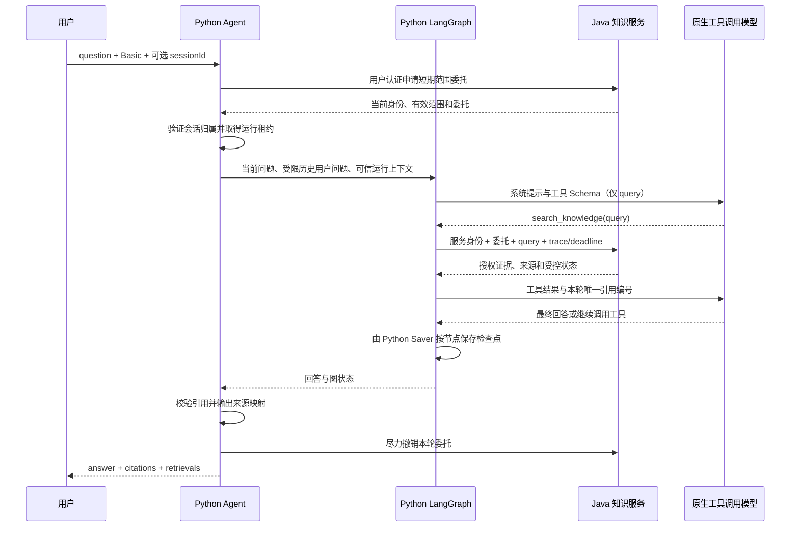

# Agent Workbench 架构边界

确认日期：2026-10-28；2026-11-02 完成实际 Python 主 Agent 入口及验证。以下职责已经落实到当前目录和接口；业务 MCP 工具等未实现部分单独标注。

## 能力归属

| 能力 | 归属 | 原因 |
|---|---|---|
| ReAct 决策、循环、动态分支 | Python / LangGraph | 属于 Agent 执行流程 |
| 工具选择、参数生成、结果反馈 | Python | 与模型决策紧密结合 |
| Graph 检查点、暂停恢复、运行取消 | Python | 与图执行状态保持一致 |
| 会话内上下文裁剪、摘要 | Python | 直接影响下一次模型请求 |
| 主 Agent 的模型调用 | Python | 直接处理工具调用与流式事件 |
| 知识库、文档、Chunk 管理 | Java | 完整的知识业务领域 |
| 文档解析、分块、Embedding、索引写入 | Java | 作为独立入库服务运行 |
| 向量、关键词检索、融合、Rerank | Java | 形成独立、可复用的检索服务 |
| 独立 RAG 问答、SSE 与独立问答历史 | Java | 使用同一个检索引擎；与主 Agent 会话分开 |
| 现有 infra-ai 能力 | Java 保留 | 继续服务 Java 的入库、检索和其他模型任务 |
| MCP 业务工具服务端 | Java | 承载业务规则、权限和事务 |
| MCP 客户端与工具装配 | Python | 服务 Agent 的运行与调用 |
| 用户、权限、配置、审计 | Java | 属于业务平台能力 |

## 协作规则

Python 持有 Agent 的决策循环、图状态和下一次模型请求所需的上下文。主 Agent 由 Python 发起模型请求，并处理工具调用及流式事件；Java 的模型基础设施继续用于 Java 自身的模型任务。

Java 持有知识业务、入库任务和检索链路。Python Agent 调用 Java 的检索服务获得结构化证据，结合自身上下文继续决策。入库任务的恢复与取消归 Java 入库系统，Graph 的检查点、恢复与取消归 Python 图执行系统。

业务工具的服务端放在 Java，执行权限检查、业务规则和事务；Python 通过 MCP 客户端发现、装配和调用工具，并把结果反馈给 Agent。权限与数据归属在 Java 服务端按现有规则校验。

用户、权限、配置和审计按实际需求扩展，沿用当前简单账号与数据归属机制；用户此前要求避免复杂用户管理。具体跨服务协议、Graph 存储和部署参数在对应实现阶段确定。

## 与当前仓库的对应

| 路径 | 当前情况与后续职责 |
|---|---|
| services/agent-service/ | FastAPI 正式入口、LangChain create_agent / LangGraph、原生模型客户端、知识工具、Python 会话和图检查点；MCP 客户端尚未实现 |
| services/backend/ | 已实现 Java 知识库、入库、检索及管理能力；后续业务平台和 MCP 业务工具服务端按需接入 |
| services/ai-service/ | 当前 Java 模型服务；承接上述保留的 infra-ai 能力，继续服务 Java 模型任务 |
| packages/java-starters/ | 已有 Java 公共组件，业务服务按需复用 |
| packages/python-common/ | 已有 Python 公共包，Agent 服务按需复用 |
| web/ | 现有 React / Ant Design / Vite 管理台，后续按实现范围增加 Agent 入口 |

## 接口与上下文传递

| 调用方 → 接收方 | 接口 | 可信数据与职责 |
|---|---|---|
| 用户 → Python | `POST /api/agent/chat` | 原 Basic 账号；question 与可选新会话范围只是请求意图，服务端生成 sessionId/runId |
| Python → Java | `POST /api/rag/delegations` | 转交当前用户认证，由 Java 确认 tenant/user、会话及实际库/文档范围；不使用万能用户 |
| Python 工具 → Java | `POST /internal/rag/retrieve` | 服务 ID/Bearer + 用户委托 + requestId/traceparent/deadline；固定 INDEPENDENT，Java 再做范围与有效版本检查 |
| 用户 → Java | `POST /api/rag/answer`、`/stream` | Java 独立问答，不经过 Python，也不写 Python 检查点 |

`services/agent-service/src/agent_service/knowledge/adapter.py` 是唯一 Python 知识适配实现。原 examples 入口只转发到它；Python 无向量库、BM25、融合、精排或证据回表实现。`graph.py` 注册的 search_knowledge 在模型 JSON Schema 中只有 query；ToolRuntime.context 注入身份、租户、会话、授权范围、短期委托、截止时间和本轮引用表，不把这些交给模型填写。

Java 的 Flyway 表只持有知识业务、独立问答、委托和检索取消控制数据。Python 的 sessions.sqlite 只持有 Agent 会话归属/范围/租约，checkpoints.sqlite 由 AsyncSqliteSaver 管理图消息。两端不直接操作对方业务表；Python 主模型客户端直接调用受控供应商原生协议，不把 Java 的独立答案再转述一次。

每轮恢复先用当前用户申请新委托、校验会话归属；在任何模型调用前清除旧助手和 ToolMessage，只保留受限的近期用户问题。当前策略重新检索所需证据，不自动复用旧答案/敏感摘录，不暴露原始检查点恢复接口。合法 traceparent 只用于关联，不作为身份或授权依据。

Python 运行与边界见 [Agent 服务](../services/agent-service/README.md)，接口见 [RAG API](rag/API.md)，联调分层见 [验证记录](rag/AGENT_RUNTIME_VALIDATION.json)。真实供应商效果、业务 MCP 工具、人工中断恢复与生产部署未验收。知识库历史交付见 [方案](knowledge-base/PLAN.md) 和 [进度](knowledge-base/PROGRESS.md)。
