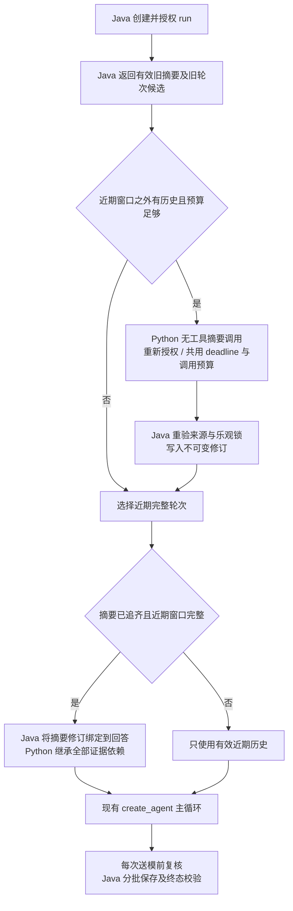

# 受授权会话摘要（第二轮）

2026-11-07。本轮只增加持久摘要及其派生依赖；原始会话、消息、工具时间线和引用快照仍由 Java 保存。没有长期记忆、图恢复或新的 ReAct。

## 职责与流程

摘要调用在图启动前由 `context/summary.py` 协调，使用 lifespan 中已有 ChatOpenAI 和 HTTP 连接池，SDK 重试仍为0。不启用内置 SummarizationMiddleware 的独立重试，不另建摘要框架。摘要不经过 answer 回调；调用设置 `lc_source=summarization`、`context-summary` 标签，并在 SSE 适配器额外排除这些标记。

上下文策略使用彼此独立的三档水位：完整模型请求达到可用输入预算约50%时，优先省略本轮可重新查询的旧工具正文；近期完整历史达到约80%时才尝试摘要；摘要后按约20%的可用输入预算保留连续的近期完整轮次。`AGENT_HISTORY_TURNS` 只是单次读取和摘要边界的安全上限（默认24），不是“超过6轮就摘要”的触发条件。一次最多处理最早的8个完整旧轮次，每个 Agent run 最多提交一个修订、最多发起一次摘要模型调用。积压超过8轮时推进有界水位，后续用户请求继续推进；未追齐时不将半段摘要拼成完整背景，回退到80%以内的近期窗口。若最近单个完整轮次已超过20%目标，明确返回预算不足，而不截断该轮。没有后台任务或自动重放。

摘要使用主模型同一输出上限、计数器和硬预算。调用前按无工具 + JSON object 真实设置估算请求；超额则跳过。为主 Agent 至少保留两次模型调用；摘要默认最多10秒且不能超过本轮剩余 deadline，外部取消或 Java 取消均中止该 HTTP。计数、I/O及保存都在原总 deadline 内；取消后的短结算预算继续沿用已有规则。

## Java 内部契约

以下路径都位于 `/internal/agent/conversations/{id}`，响应仍是 `Result` 包装，`Cache-Control: no-store`。沿用已验证的服务 Bearer、`X-Rag-Service`、用户 `X-Rag-Delegation`、`X-Rag-Deadline`、`X-Request-Id` 和 `traceparent`；租户/用户/会话/固定KB和文档范围不从模型参数获取。run 必须归属该会话、当前服务且仍在运行。

| 方法与路径 | 请求 / 返回 |
|---|---|
| GET `/context-summary` | `runId`、`retainedTurns=6`（1–24）、`policyVersion`（必填，最多120字符）；返回 `expectedRevision`、当前有效 `summary` 或 null、最多8个 `turns`、`sourceHash`、`throughSequence`、`hasMore`、`caughtUp` |
| PUT `/context-summary` | `runId`、`expectedRevision`、`retainedTurns`、准备接口的 `sourceHash`、`content`、`model`、`promptVersion`、`promptHash`、`policyVersion`；返回新 `revision/throughSequence` |
| POST `/context-summary/use` | `runId/revision/retainedTurns/policyVersion`；只有已追齐、来源有效的当前修订才能在首次回答检查点前绑定，返回 `revision` |

GET 以 run 的用户消息 sequence 固定排除上界；`throughSequence` 为已整理旧轮次的助手位置（含不可用助手的占位边界）。Java 计算来源消息指纹和水位，不采信模型自行声明的覆盖范围。无效摘要正文和失效助手正文都不返回。无效最新修订仍占用 revision，重建时 CAS 不退回0。

`content` 含 `goals/constraints/facts/openQuestions` 四个数组，每类最多12项，每项 `{text, sourceMessageIds}`，正文最多1000字符、来源1–8个真实消息UUID，总序列化内容最多8192字节。constraints 每项只能来自一条用户消息且是连续原文；已有摘要的约束必须原样保留。其余字段仅验证结构和来源成员，不代表语义、事实或完整性已获保证。

常见状态：400 参数不合法；401 服务或委托认证失效；404 会话/run 不归属或已删除；409 `AGENT_SUMMARY_CONFLICT/SOURCES/DEPENDENCIES`、`EVIDENCE_CHANGED`、运行已结束等；413 `CONTEXT_BUDGET`（内容、来源或依赖超过限制）；503 会话依赖不可用。客户端只暴露受控错误，不传 SQL、私有地址或供应商原始错误给模型。

## 存储和失效

Flyway V13 新增 `kb_agent_context_summary`，按会话及 revision 保存不可变派生记录，记录 run、来源消息指纹、throughSequence、sourceHash、结构内容、证据依赖、模型及提示/策略版本；消息增加 `context_summary_revision` 外键。Java 会话行锁、expectedRevision、来源重新计算及唯一 run 约束阻止陈旧/重复提交。删除会话先删除消息再清理摘要，保留既有最小请求墓碑规则。

来源上限512条、摘要证据最多64份且序列化最多128KiB；近期历史与摘要合并后仍受64份/128KiB限制，新增工具之后沿用单轮128份和原检查点上限。来源包括使用过的先前摘要的传递来源，不能把敏感事实只保留成无依赖文字。复用时在数据库按规范JSON生成SHA-256指纹，只读取指纹而不搬运全部旧正文，并用现有 ConversationEvidence 回表确认当前知识权限、启停、删除、activeGeneration、正文/元数据哈希。

撤权或来源变化使该修订整体失效；主模型调用前重新检查，写回也检查。已经采用摘要的回答必须携带全部摘要证据依赖，Java 强制拒绝遗漏；历史展示同时验证原摘要修订，因此派生回答不能在撤权后继续展示。旧 K 编号不作为本轮可引用证据，需要引用时重新检索。

摘要复用键包括当前会话归属/委托范围、模型/预算策略、中文提示词哈希及保留轮次。模型或配置变化后旧摘要不直接复用，从当前安全原记录重建；没有跨用户缓存或 TTL 放行。摘要模型失败、格式错误、调用超时或调用取消时不提交新记录、不推进水位，近期窗口仍超限则按原逻辑明确失败。服务不可用或鉴权失效不能伪装成无历史。若提交阶段响应丢失，提交结果以Java当前修订为准，不盲目重放或推断未落库。

## 配置和排障

- `AGENT_SUMMARY_ENABLED=true`，可设置 false 回退第一轮近期上下文策略；关闭不删除既有摘要。
- `AGENT_SUMMARY_TIMEOUT=10`，范围1–30秒；总耗时、max_model_calls 和 max_output_tokens 继续使用已有配置。
- 同一 Chat Completions 模型需要支持 `response_format: {type: json_object}`。不支持或输出不合格时仅本轮一次失败尝试并回退，没有供应商能力自动探测或无限重试。
- 受控日志 `agent_summary` 含 trace_id、policy、outcome、输入字节及估计Token，不含原文、凭据或推理。`invalid_or_timeout` 检查模型输出和期限；`source_or_budget_changed` 检查权限/来源/预算；`model_unavailable` 检查服务配置。摘要正文只可通过受委托内部接口读取，不加入用户SSE或普通来源抽屉。
- 512来源/64依赖达到上限后回退近期历史，不能宣称全会话永久记忆；必要时新建会话。窗口未覆盖的旧条件可能丢失，需澄清，不会自动恢复业务工具。

## 验证和效果限制

定向记录见 [SUMMARY_VALIDATION.json](SUMMARY_VALIDATION.json)。Java 使用真实隔离PG/pgvector/MinIO，模型为HTTP桩；Python 使用真实 create_agent、HTTP模型和Java契约桩。覆盖保存与增量重建、原文约束、依赖继承、撤权发生在提交前/派生后、错误来源及CAS、取消/超时/输出失败和调用预算、SSE隔离、trace关联以及会话删除。没有新增前端协议，不重复运行前端检查。

这些验证不等于真实供应商的摘要效果评估。尚无摘要压缩率、限制/编号召回率、事实保真度、成本收益或容量结论；默认6轮/8轮批次/10秒不是通用最优参数。原文与来源格式校验无法证明模型没有遗漏重要约束，也不能使历史助手答复变为真实业务完成凭证。
