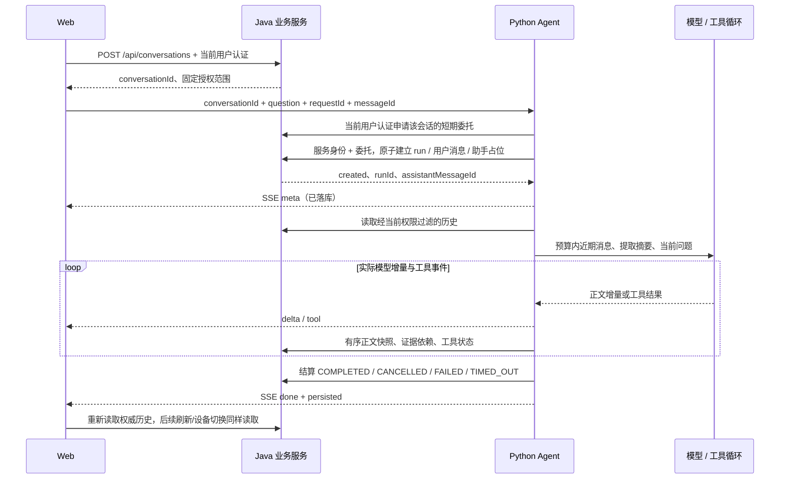

# Agent 会话、历史与流式执行

2026-11-05。本文是当前契约，替代 2026-11-02 的 Python 自有 sessions.sqlite / 网页临时历史方案。知识管理、共享检索和 Java 独立问答接口保持各自职责。

## 职责与数据

Java `backend/agent` 管理业务会话、消息、运行权、证据依赖及展示权限；复用 JDBC、事务、Basic、服务身份和短期委托。Flyway V11 新增：

| 表 | 内容 |
|---|---|
| kb_agent_conversation | tenant/owner、标题、固定知识范围、创建/活跃时间、消息序号、创建幂等键和删除墓碑 |
| kb_agent_run | 会话、requestId、用户/助手 messageId、服务、traceId、deadline、状态、检查点序号及不可变结束时间 |
| kb_agent_message | user/assistant、正文、顺序、请求/运行关联、状态、工具展示事件、模型/提示词、引用、模型可见证据快照及知识版本 |

Java 的 `kb_rag_conversation/kb_rag_answer_run` 继续用于独立问答，不混作 Agent 历史。Python 不读写这些数据库表，通过受授权 HTTP 接口操作；删除 sessions.py，不再创建 sessions.sqlite。LangGraph 仍管理当前图执行检查点，但按 runId 隔离，执行结束后用 Saver API 清除；进程启动清除遗留图，绝不按历史加载恢复工具节点。AGENT_STATE_DIR 只能给单个进程独占，不能多个 worker 共享。



## Java 公开接口

均沿用当前用户 Basic，tenant/user 从认证主体获取，不能由 JSON 或头自报。成功返回原 Result 封装，删除为 204。响应 `Cache-Control: no-store`。静态 OpenAPI 为 `/openapi/conversations.json`。

| 方法与路径 | 请求 / 响应 |
|---|---|
| POST /api/conversations | `{requestId: UUID, title?: string, kbIds?: UUID[], documentIds?: UUID[]}` → 201，会话；省略范围按现有知识权限解析并固定 |
| GET /api/conversations | current=1、size=30（1–100）、search（标题，最多120字符）；返回 current/size/total/records，按 activeAt/id 降序 |
| GET /api/conversations/{id} | 当前会话、标题、范围、createdAt、activeAt、最近运行状态 |
| PATCH /api/conversations/{id} | `{title}`，非空、最多120字符；返回当前会话 |
| DELETE /api/conversations/{id} | 终止活动 run，物理删除正文/证据/工具消息，保留最小创建/请求墓碑；不修改知识文档 |
| GET /api/conversations/{id}/messages | size=30（1–100）、beforeSequence（省略取最新页）；records 在页内升序，另有 hasMore / nextBeforeSequence，可向前加载；空页游标为0，避免将 Long.MAX_VALUE 传入浏览器 |
| GET /api/conversations/{id}/runs/{runId} | `{run,message}`，包括最后保存的正文和真实运行状态；不触发执行 |
| POST /api/conversations/{id}/runs/{runId}/cancel | 原子取消本人 RUNNING；已结束返回既有状态 |
| POST /api/conversations/{id}/delegations | `{serviceId}`，用会话已保存的固定范围签发原短期委托；Python 使用，浏览器不接收令牌 |

创建会话相同 owner + requestId + 原请求内容返回原会话，内容不同为409。会话知识范围不能通过后续提问扩大。越权/其他租户/删除资源均404，服务身份本身不授予用户权限。

消息包含 id、runId、requestId、sequence、role、content、status、createdAt/updatedAt、model、promptVersion/promptHash、citations、evidence、tools、sourcesRestricted。tools 仅含注册工具名称、调用 ID、检索状态、requestId/traceId 和受控降级/错误标识，不返回原始图、工具正文、SQL、凭证或内部地址。

evidence 保存实际交给模型的摘录、来源定位、kb/document/chunk、generation、sourceContentHash、snapshotHash 和检索返回的模型/索引版本。工具裁剪后重新计算实际摘录哈希。完整版本信息通过可信引用注册表写 Java，模型工具视图只包含版本指纹，避免将追踪元数据挤入工具正文预算。citations 是这些快照中答案实际引用的子集，不将未引用候选标成引用。

读取每页或供模型读取历史时，复用 EvidenceRepository 对 tenant/owner、删除、文档/Chunk 启停、activeGeneration 和嵌入配置进行回表，同时核对正文哈希与定位。任何一个模型可见依赖失效，则隐藏整个派生助手回答及其来源，返回 sourcesRestricted=true；数据库原快照保留，直到会话删除。用户原消息仍按本人会话权限展示。若新回答使用了历史助手内容，也继承其证据依赖，防止通过后续回答绕过撤权。

## Java 内部接口

认证头复用 `Authorization: Bearer <service token>`、`X-Rag-Service`、`X-Rag-Delegation`。委托必须绑定当前会话、用户/租户、配置服务及相同固定知识范围。每次重查用户状态和委托有效性；不允许只用服务凭证读历史。

`X-Request-Id` 为传输关联 ID，`traceparent` 沿用校验后的 W3C 链路（只关联，不授权），`X-Rag-Deadline` 必须为未来 ISO 时间，内部元数据最多允许125秒。业务幂等使用 JSON requestId/messageId；执行 deadline 另外受120秒服务器上限和委托到期时间封顶。

| 方法与路径 | 内容 |
|---|---|
| POST /internal/agent/conversations/{id}/runs | `{requestId,messageId,question,deadline}`；原子建立用户/助手两条消息并分配 runId，返回 created、所有关联 ID、traceId/status/deadline/checkpointSequence |
| GET /internal/agent/conversations/{id}/history | 最近最多60条完成且有效的用户/助手消息，以及助手的当前有效证据依赖；排除失败/取消/失效助手消息，不返回原始 ToolMessage |
| GET /internal/agent/conversations/{id}/runs/{runId} | 当前 `{run,message}`，用于跨实例取消和重试状态确认 |
| PATCH /internal/agent/conversations/{id}/runs/{runId} | `{sequence,status,content,evidence,citations,tools,model,promptVersion,promptHash,errorCode}`，提交完整有序快照 |

同一会话仅一个 RUNNING；不同请求并发409/SESSION_BUSY。相同 requestId + messageId + question 返回 created=false，任何状态均不得再执行图；更改内容409/AGENT_REQUEST_CONFLICT，全局复用消息 ID409。相同 checkpoint sequence/内容可重复提交，内容冲突或陈旧序号409；正文只可追加，已有快照不可移除。

COMPLETED/FAILED 不可改写；取消和超时后的5秒只允许原执行保存已经生成的末尾片段，终态不能复活，宽限不会被更新延长。超时由持久 deadline 和5秒清扫结算；读取消息/运行也会进行惰性过期。崩溃最多丢失尚未成功提交的批次，不承诺每个 token 必达或供应商立即停止计费。

## Python 流式接口

`POST /api/agent/chat/stream` 必须提供以下字段（UUID），不接受自报身份、模型或工具列表：

```json
{
  "conversationId": "00000000-0000-0000-0000-000000000001",
  "requestId": "00000000-0000-0000-0000-000000000002",
  "messageId": "00000000-0000-0000-0000-000000000003",
  "question": "PostgreSQL 如何备份？"
}
```

用户 Basic 由 Python 转交 Java 的会话委托接口校验。首次 meta 之前的认证、权限、预算等错误返回正常 HTTP 状态码；开始后用安全 SSE 事件报告错误。流有32项背压队列，每秒心跳，原生模型文本流，不包含 reasoning 内容。

| SSE 事件 | 数据与含义 |
|---|---|
| meta | Java 已创建/复用的会话/请求/消息/run ID、traceId、status、deadline、created、persisted=true |
| delta | `{messageId,text}`；真实模型可见正文增量。尚未终态的文字应显示为生成中 |
| tool | 工具调用 ID、search_knowledge、RUNNING 或四种检索结果状态，以及受控关联/降级字段 |
| error | `{code,persisted}`，无原始异常或地址；persisted=false 时不能宣称已保存 |
| done | 已确认的运行终态和 persisted；成功包含 answer/citations/retrievals/模型与提示词版本，重复提交另有 replayed=true |

delta 为实时展示，不等同每个增量都已落库；脏正文约0.4–0.5秒一次批量保存，工具变化及终态立即提交。客户端断开取消图与 HTTP，并在额外3.5秒预算内尽力保存末尾正文，随后尽力撤销委托。Starlette 的取消域中保护这段短清理，避免二次取消中断结算。Java不可达时由持久 deadline 收敛；Web读取 Java 权威结果。取消已标记的 RUNNING 工具最终显示 UNAVAILABLE，不把加载历史当成重新调用授权。

不自动重连/重放流，不支持 Last-Event-ID 事件重放；同 requestId 重提只返回既有运行，不生成第二条答案。刷新、网络中断或未知状态时调用 Java 消息/运行 GET。流丢失不意味着业务未执行，今后接入有副作用工具仍须各自业务幂等键，当前实际工具只有检索。

`POST /api/agent/chat` 保留完整 JSON 能力，同样使用 Java 账本；支持新三标识，以及旧 sessionId 别名/首次无 ID 自动创建会话。旧调用若省略请求/消息 ID，由服务生成，无法将两次独立 HTTP 调用识别为同一次用户操作；新客户端必须显式传 ID。旧 Python sessions.sqlite 的会话无法作为新 Java 会话 ID 使用，不自动从旧图导入无法验证的历史。

## 上下文与限制

Python 从 Java 最近60条中选择最多12条完整近期消息，合计最多 min(24000, context_byte_budget/2) UTF-8 字节。更早最多8条用户问题各取160字符，形成最多2048字节提取摘要；不是 LLM 自动摘要，不包含旧工具正文。超长助手消息或证据依赖过多时跳过，不裁断事实后冒充完整答案。

历史助手依赖最多64份/128KiB，单轮总依赖最多128份；只用于权限追溯。历史 K 引用进入模型前去除，不加入本轮引用注册表；需要引用时重新检索。每次模型调用前再次确认历史仍可用、保存/检查当前证据。最终编号校验只证明引用来自实际证据，不能证明事实或语义正确。

默认总耗时60秒、并发4、模型调用8次、工具6次、工具视图4096字节、上下文60000字节，SDK重试0。图暂停恢复、业务工具、跨进程共享检查点、真实供应商效果和生产容量没有因此获得验收。
