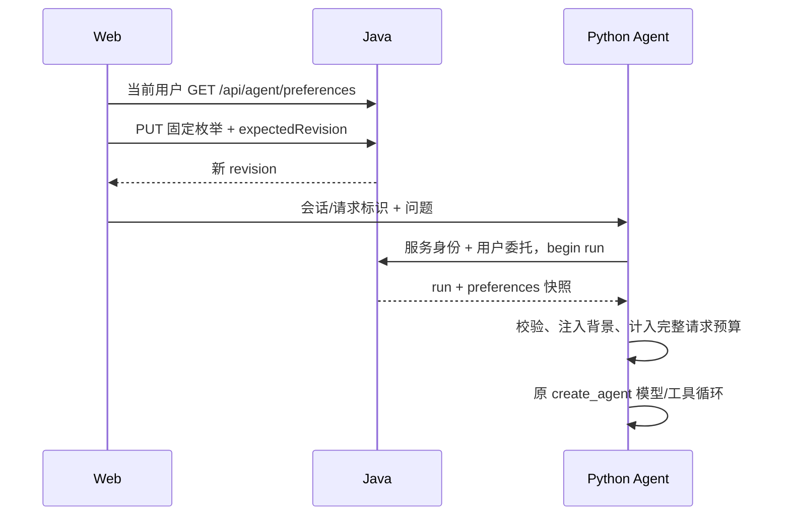

# 用户回答偏好

2026-11-07。本轮交付用户主动管理的跨会话表达偏好，沿用 Java 权威业务数据和 Python 主 Agent；没有自动事实抽取、模型记忆写入工具或图恢复。

## 数据与模块

| 职责 | 实现 |
|---|---|
| 归属、保存、重置 | Java backend/agent 的 AgentPreferences、认证主体、JdbcTemplate 短事务 |
| 用户设置 | Web 聊天侧栏账号菜单 → 回答偏好；现有 Ant Design 弹窗 |
| 运行绑定 | ConversationLedger 建立 run 时保存不可变 preferences_snapshot |
| 模型输入 | Python context/preferences.py 严格校验 Java 快照，生成一次背景消息 |
| 中文提示词 | agent-preferences-v1.txt，与系统/知识模板一起记录版本和哈希 |

Flyway V14 新增 kb_agent_preferences，主键 tenant_id + owner_id；kb_agent_run 增加 JSONB 快照列，旧运行补默认快照。未设置用户读取虚拟默认值，不创建行。没有知识索引、嵌入配置、新依赖或环境变量变化。



设置在之后建立的新运行生效，包含原会话下一轮；当前运行继续使用绑定版本。相同请求标识重提保留原快照，不重新执行。与保存并发建立的运行可能取得保存前或保存后的完整版本，不承诺取消正在生成的回答。偏好跨会话生效，删除会话不删除用户偏好。

## 公开契约

沿用当前用户 Basic 和 KB_USER 权限链，tenant/owner 只从服务端 principal 获取。成功为200、现有 Result 封装和 Cache-Control: no-store；没有指定他人用户、租户或 scope 的参数，也没有万能服务身份读写接口。

| 方法与路径 | 请求 |
|---|---|
| GET /api/agent/preferences | 无请求体 |
| PUT /api/agent/preferences | `{"expectedRevision":0,"language":"EN","detail":"CONCISE","format":"BULLETS"}` |
| POST /api/agent/preferences/reset | `{"expectedRevision":1}` |

响应 data 示例：

```json
{"revision":1,"epoch":0,"language":"EN","detail":"CONCISE","format":"BULLETS","updatedAt":"2026-11-07T12:00:00Z"}
```

| 字段 | 允许值 / 默认值 |
|---|---|
| language | AUTO（默认）、ZH_CN、EN |
| detail | BALANCED（默认）、CONCISE、DETAILED |
| format | AUTO（默认）、PARAGRAPHS、BULLETS |
| revision | 非负整数，每次成功保存/重置加一；未设置为0 |
| epoch | 非负整数，每次重置加一；未设置为0 |
| updatedAt | 服务端时间，未设置为 null |

不支持自由文本。缺失必填字段、负版本或非法枚举400；未认证401，无用户角色403；陈旧版本409 AGENT_PREFERENCES_CONFLICT。写操作要求全部三个枚举，行锁比较 expectedRevision 后更新。重置恢复默认但保留递增版本，旧页面必须重新加载再明确保存；不自动重放写入。网络结果未知时先读当前设置。

内部 begin/get run、公开本人 run 响应中的 preferences 为绑定快照；SSE meta 沿用 run 字段增加该对象，没有新事件类型。Python 不接受聊天请求或模型自报偏好，工具参数仍只有 query。机器契约同步至 openapi/conversations.json。

## 模型上下文、权限和追踪

Python 在摘要或主模型调用前使用 Pydantic 校验快照；缺失、非法枚举、额外字段或非法版本以502 INVALID_PREFERENCES 停止，不猜测。默认三项不增加动态消息；非默认值通过固定枚举映射成一条 HumanMessage，放在本轮历史之前，每次模型请求只有一份。它与系统模板、工具 schema、历史/摘要、问题和结果一起计入原预算，没有额外模型调用或缓存。

偏好仅影响语言、详略和格式，当前问题明确要求优先；不能成为知识事实、证据、身份、审批或操作授权，也不能削弱引用及故障处理。摘要模型保持既有中文结构化任务，Java 独立 RAG /answer 本轮不接入此设置。提示与枚举校验不保证模型遵循风格或事实正确。

运行快照保留实际版本，提示词版本/hash沿用消息记录。恢复默认不删除旧运行审计、答案或摘要；删除会话按原规则清理其运行和消息。浏览器不另存设置或凭证，重新登录向 Java 加载。没有自动提取任务；将来事实记忆需独立设计来源、epoch、撤权和用户删除语义。

## 启用与排障

先备份 PostgreSQL，在未被运行进程占用的隔离目录构建并部署 Java，确认 V14，再更新 Python 和 Web。新 Python 需要含 preferences 的 run 响应，单独升级会明确失败。Vite dev/preview 仅将 /api/agent/chat 及其流路径代理到 Python；Nginx 对该路径及子路径分流，其余 /api/agent/preferences、reset、会话 API 发往 Java。生产仍需 HTTPS 和现有认证。

设置页404先检查代理目标及 Java 版本；409重新加载后选择，不自动用新版本覆盖旧写入；INVALID_PREFERENCES核查两端契约。不能通过偏好调整检索授权、模型或上下文硬上限。

验证分层见 [PREFERENCES_VALIDATION.json](PREFERENCES_VALIDATION.json)。Java 使用隔离 PG/MinIO；Python 运行真实图但 Java/模型为协议桩；浏览器连接本机真实 Java。尚无真实模型风格、事实质量、生产负载或并发压力评估。本轮到此结束。
